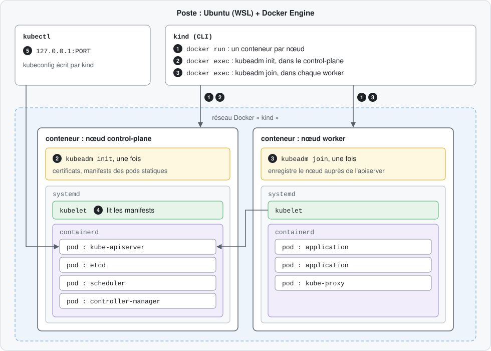
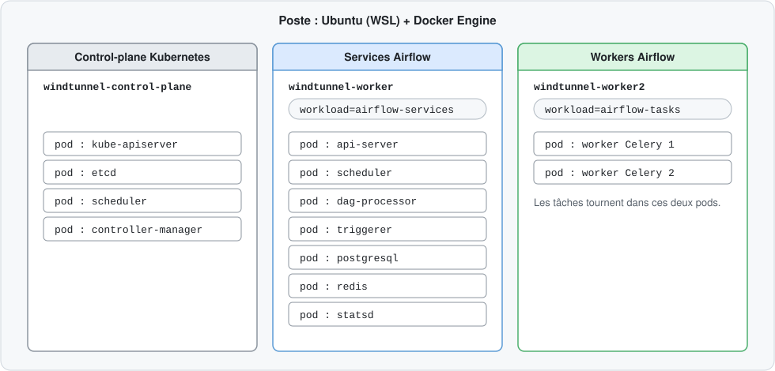

# kind : simuler un cluster Kubernetes

La démarche vise une configuration d'Airflow déployée en production, sur un cluster Kubernetes ou
des VM. Dans ce projet, **kind** (Kubernetes IN Docker) simule ce cluster sur un poste : il permet
de dérouler la démarche de bout en bout, sans vrai cluster.

## Un nœud est un conteneur



Le schéma montre le cas général, à deux nœuds. Le projet en déclare **trois** dans
[deploy/kind-config.yaml](../deploy/kind-config.yaml) : un control-plane et deux workers.

## L'architecture déployée



Après la création du cluster, un label attribue son rôle à chaque worker :

```
$ kubectl label node windtunnel-worker  workload=airflow-services
$ kubectl label node windtunnel-worker2 workload=airflow-tasks
```

[deploy/values.yaml](../deploy/values.yaml) place ensuite chaque composant par un `nodeSelector`
sur ce label.

| Composant | Clé du chart | Nœud visé |
| --- | --- | --- |
| api-server, scheduler, dag-processor, triggerer | `<composant>.nodeSelector` | `workload: airflow-services` |
| Redis | `redis.nodeSelector` | `workload: airflow-services` |
| PostgreSQL | `postgresql.primary.nodeSelector` | `workload: airflow-services` |
| statsd | `statsd.nodeSelector` | `workload: airflow-services` |
| Jobs d'installation : migration de la base, création de l'utilisateur | `migrateDatabaseJob.nodeSelector`, `createUserJob.nodeSelector` | `workload: airflow-services` |
| Workers Celery | `workers.celery.nodeSelector` | `workload: airflow-tasks` |

## Les étapes

| Étape | Commande | Ce qui se passe |
| --- | --- | --- |
| ① | `docker run` | kind démarre un conteneur par nœud. L'image `kindest/node` embarque systemd, kubelet et containerd. |
| ② | `kubeadm init` | Exécuté une fois dans le control-plane : il génère les certificats et les manifests des pods statiques, puis se termine. |
| ③ | `kubeadm join` | Exécuté une fois dans chaque worker : il enregistre le nœud auprès de l'apiserver, puis se termine. |
| ④ | kubelet | Il lit les manifests et lance les pods du control-plane par containerd. |
| ⑤ | `kubectl` | Il atteint l'apiserver par un port publié sur `127.0.0.1`, avec le kubeconfig écrit par kind. |

**kubeadm amorce le cluster, le kubelet le fait vivre.** kubeadm ne reste pas actif : une fois
les manifests écrits, c'est le kubelet qui maintient les pods.

## Ce que cela implique pour le déploiement

Les pods sont des **conteneurs dans le conteneur** : c'est le containerd du nœud qui les lance,
pas le Docker du poste. Chaque cible du [Makefile](../Makefile) en découle.

| Cible | Ce qu'elle fait | Pourquoi |
| --- | --- | --- |
| `make cluster` | Crée le cluster décrit par `deploy/kind-config.yaml`, puis pose le label de chaque worker | Le kubeconfig est un fichier dédié, `~/.kube/windtunnel` : les contextes Kubernetes du poste restent intacts |
| `make image` | Construit l'image `windtunnel-airflow:3.2.2` : l'image officielle d'Airflow, plus les DAGs de tir de `dags/` | Les DAGs voyagent avec l'image : tous les composants lisent les mêmes fichiers, sans volume ni synchronisation Git |
| `make images` | Construit cette image, puis la charge dans chaque nœud avec celles des autres composants | Un nœud neuf démarre vide, et son containerd ne voit pas les images du Docker du poste |
| `make chart` | Installe le chart Helm d'Airflow dans le namespace `airflow` | Helm parle à l'apiserver comme `kubectl`, par le même kubeconfig |
| `make down` | Supprime le cluster | Supprimer le cluster, c'est supprimer ses conteneurs : rien ne reste sur le poste |

## Ce que kind ne simule pas

Sur kind, chaque nœud voit toutes les ressources du poste : la **capacité du cluster** n'est pas
bornée comme en production. Un tir qui dépend de cette borne doit la poser lui-même.
